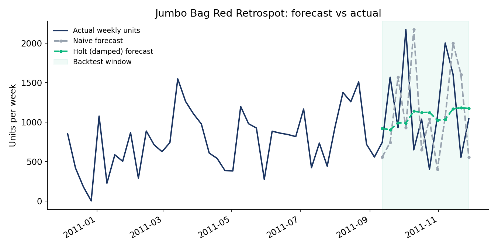
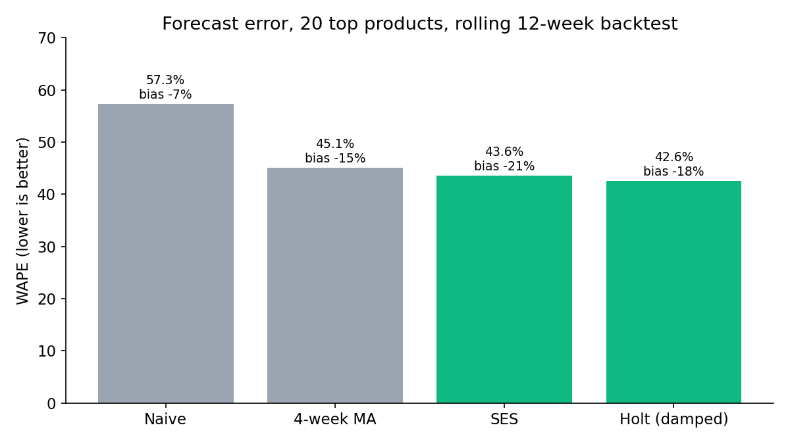
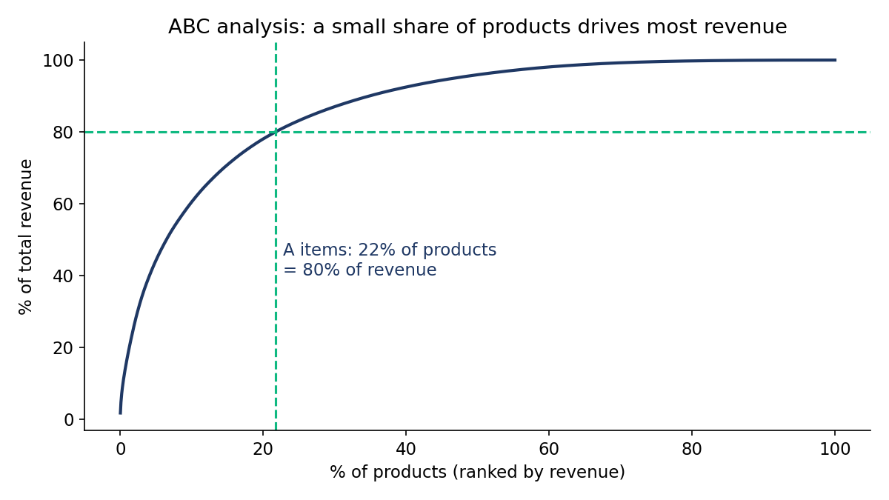
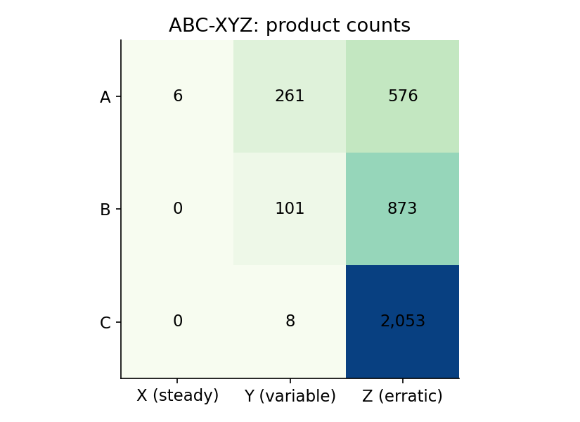

# Retail Demand Planning: Forecasting + Inventory Policy

Weekly demand forecasting and safety-stock planning on **541,909 real transactions** from a UK online retailer (Dec 2010 – Dec 2011). The pipeline cleans the data, compares four forecasting methods with a leakage-free backtest, classifies 3,878 products with ABC-XYZ analysis, and sets safety stock and reorder points for the top products.



## Key results

| | |
|---|---|
| Clean data | 495,235 transactions, 3,878 products, 52 full weeks, £9.24M revenue |
| Best forecast method | Holt (damped trend), **42.6% WAPE** vs 57.3% for a naive forecast (**-26% error**) |
| Forecast bias | All methods **under-forecast by 7–21%** in the test window (pre-Christmas ramp-up) |
| ABC analysis | **22% of products = 80% of revenue** (843 A items) |
| ABC-XYZ | 576 of 843 A items have **erratic demand (Z)**, so they need planner review, not just a formula |
| Inventory policy | Safety stock and reorder point for the 20 top products at 98% / 95% / 90% service levels by class |

## What it does

1. **Clean** (`src/01_clean.py`): removes cancelled invoices, the orders they cancelled (matched by customer, product and quantity, otherwise a cancelled 80,995-unit order would count as demand), zero/negative quantities and prices, non-product codes (postage, fees, adjustments), and the partial first/last week. Every rule logs how many rows it removed.
2. **Forecast** (`src/02_forecast.py`): for the 20 highest-revenue products that sold in at least 40 of 52 weeks, compares Naive, 4-week moving average, simple exponential smoothing and Holt (damped trend). Rolling-origin backtest over the last 12 weeks: each forecast only uses data before the week it predicts.
3. **Inventory policy** (`src/03_inventory.py`): ABC by revenue (80/15/5), XYZ by coefficient of variation (<0.5 / 0.5–1.0 / >1.0), then
   `Safety stock = z × σ_error × √L` and `Reorder point = forecast × L + safety stock`,
   where σ_error is the standard deviation of the chosen method's backtest errors.
4. **Charts** (`src/04_charts.py`).

## Why these choices

- **WAPE instead of MAPE:** MAPE divides by each week's actual demand and breaks on zero-sales weeks. WAPE (total absolute error / total demand) is stable and weights errors by volume.
- **Bias tracked separately:** a method can have low error but consistently under-forecast, which means stock-outs. Here every method under-forecasts the autumn ramp-up because one year of data cannot teach a model seasonality.
- **Safety stock from forecast error, not demand variance:** what you need to buffer against is how wrong the forecast is, not how much demand moves.



 

## Sample output: inventory policy (top 5 by reorder point)

| Product | ABC-XYZ | Method | Forecast / week | Safety stock | Reorder point |
|---|---|---|---|---|---|
| Popcorn Holder | A-Z | 4-week MA | 3,269 | 2,405 | 8,942 |
| Paper Chain Kit 50's Christmas | A-Z | SES | 1,626 | 1,419 | 4,671 |
| Jumbo Bag Red Retrospot | A-Y | Holt (damped) | 1,163 | 1,773 | 4,098 |
| Assorted Colour Bird Ornament | A-Y | Holt (damped) | 931 | 977 | 2,839 |
| White Hanging Heart T-Light Holder | A-Y | SES | 604 | 1,275 | 2,483 |

Full table: `outputs/tables/inventory_policy_top20.csv`.

## Assumptions and limitations

- **Lead time is assumed to be 2 weeks.** The dataset has no supplier lead times.
- **One year of data**, so no seasonal model is possible; the negative bias shows the cost of that. With 2+ years, a seasonal Holt-Winters or a seasonal uplift would be the next step.
- σ_error comes from 12 backtest weeks per product, so safety stocks are rough estimates.
- Customers are mostly wholesalers, so weekly demand is lumpy. Intermittent items (fewer than 40 selling weeks) would need methods like Croston.
- Normal-distribution safety stock is a simplification for erratic (Z) items.

## Run it

```bash
python3 -m venv .venv && source .venv/bin/activate
pip install -r requirements.txt
./run_all.sh
```

`run_all.sh` downloads the dataset from the UCI Machine Learning Repository if it is missing (about 23 MB).

## Data

Daqing Chen, *Online Retail* dataset, UCI Machine Learning Repository, 2015. https://doi.org/10.24432/C5BW33 (CC BY 4.0). Raw and processed data are not committed; the script downloads them.

## Tech

Python · pandas · statsmodels · matplotlib

Author: Abderrahmane Messaoudi, Industrial Engineering & Engineering Management, University of Sharjah · [LinkedIn](https://www.linkedin.com/in/abderrahmane-messaoudi-984161273/)
